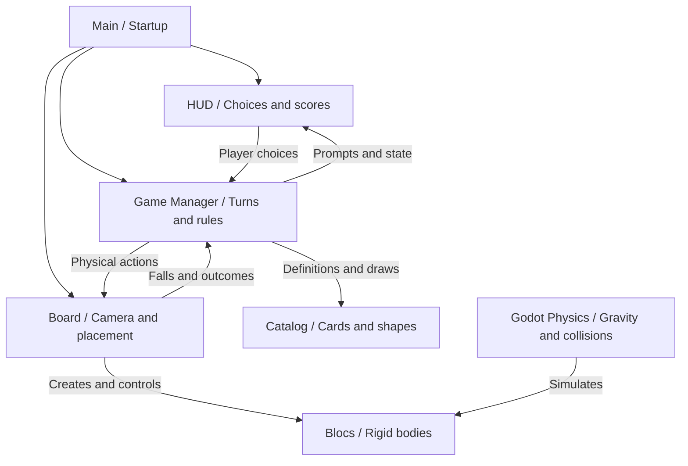

# BLOC: Current Design

BLOC is a 3D tower-building game for 2–4 players sharing one computer. Players take turns placing blocs on their towers and playing legislation cards that affect the game.

## Game flow

1. Choose the number of players.
2. **Production:** draw legislation, resolve card choices, then draw and place a bloc. Move and rotate the piece before releasing it; wait for the tower to settle.
3. **Collapse:** once supply runs out, move an existing bloc higher on your tower instead of drawing a new one.
4. **Game over:** four pieces falling in one physical action defeats their owner. An empty tower also loses at the start of its Collapse turn. Survivors are ranked by points, then fewer falls, then tower height.

## Components

| Component | Job |
| --- | --- |
| Main | Starts the game and connects its components |
| HUD | Shows instructions, choices, hands and scores |
| Game manager | Controls turns, cards, supply and winning conditions |
| Catalog | Defines cards and bloc shapes |
| Board | Handles camera, placement, validation and fall detection |
| Bloc | Represents one physical piece with meshes and colliders |

## System structure

Main starts and connects the systems. The game manager controls the rules, the HUD handles choices, and the board manages physical play.

## Current implementation

The prototype has the full turn loop, 30 supply blocs, 11 legislation cards, physics, camera controls, scoring and restart. Most visuals and UI are generated in GDScript. Reusable editor-built scenes and final presentation are not yet implemented. Online multiplayer, separate controller assignment, AI, save/load and audio are not included.

See [Component Work Remaining](COMPONENT_WORK.md) for existing functionality, remaining tasks and the proposed two-player proof-of-concept scope.
